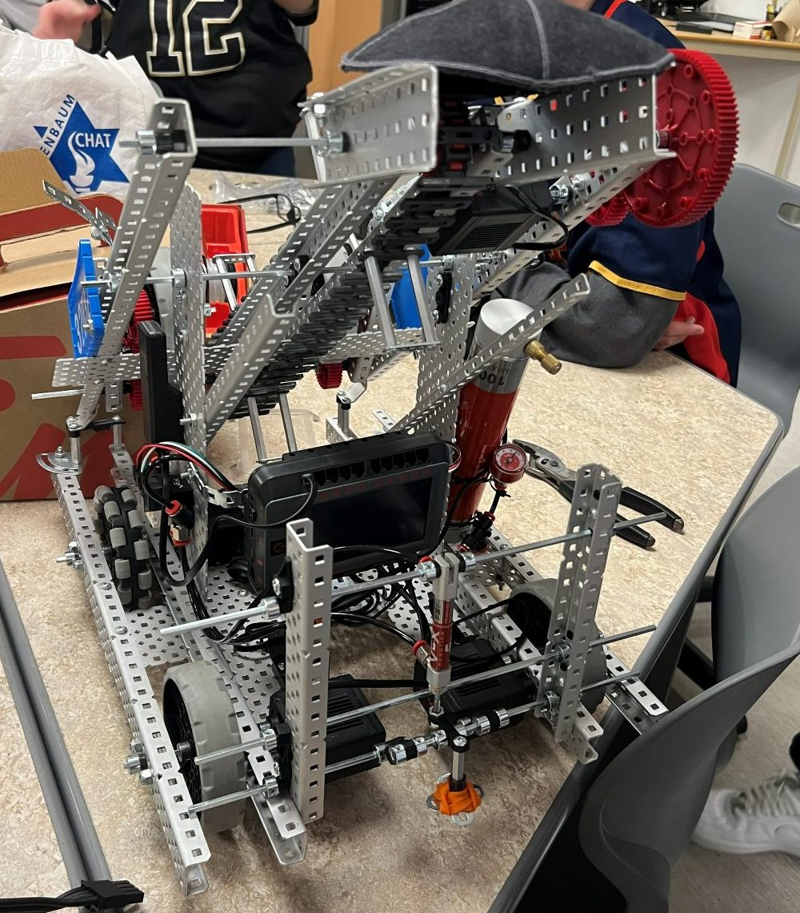
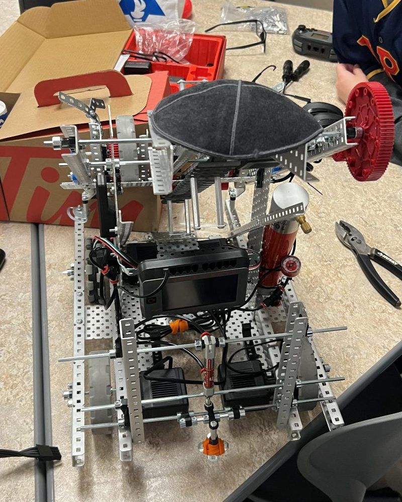
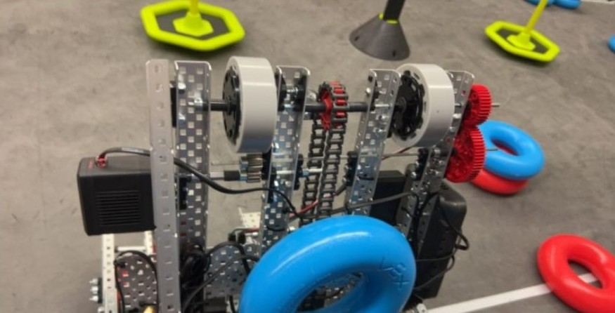
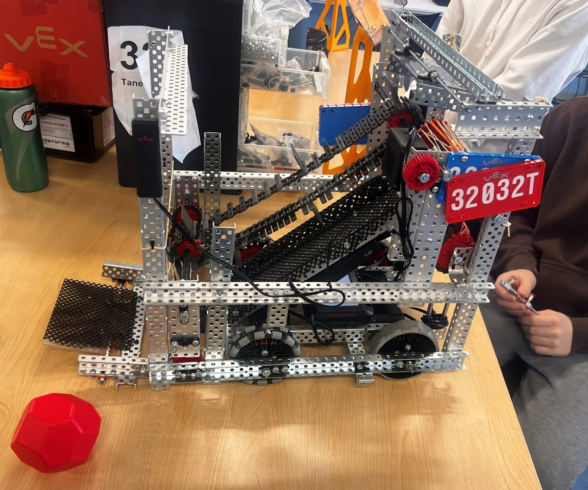
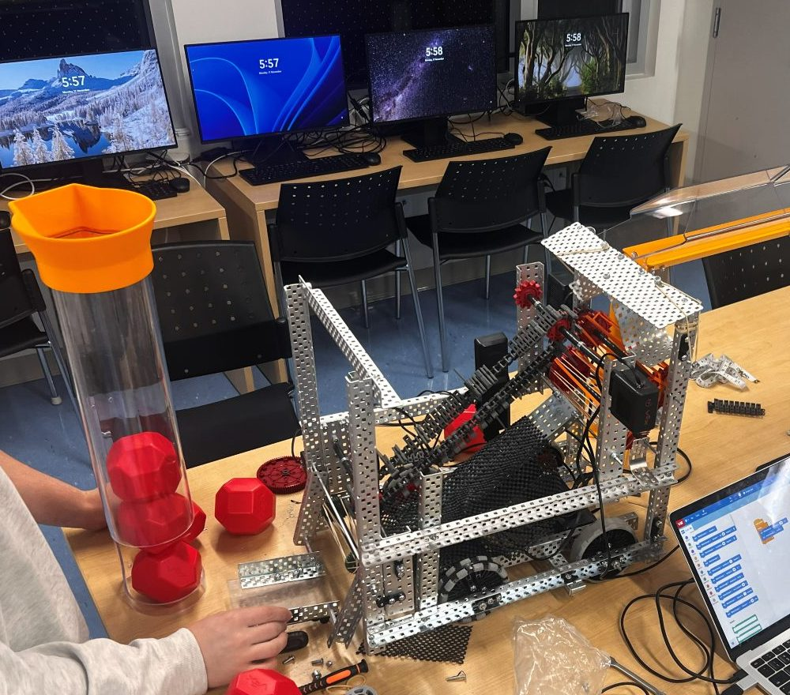
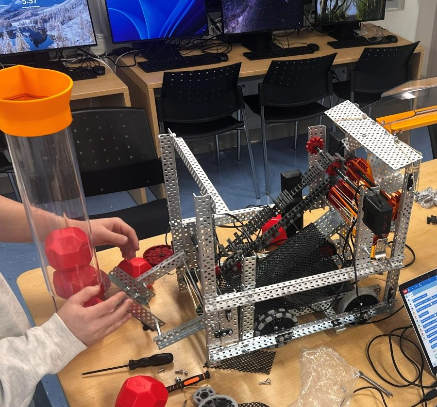

# VEX V5 Competition Robots

Two VEX V5 robots I designed and built with my high school's competitive robotics team at TanenbaumCHAT, a program I founded. I taught myself the V5 platform from scratch and led the design and build of both robots, each for a different season's game.

| | High Stakes (2024–25) | Push Back (2025–26) |
|---|---|---|
| Game pieces | Rings, scored on stakes and mobile goals | Blocks, scored in goals |
| Signature mechanism | Pneumatic mobile-goal clamp + chain hook intake | Tall frame with an angled chain conveyor and a scoring roller |
| Result | — | Finals at the Niagara Battlefields VEX V5 Competition (~20 teams) |

---

## High Stakes (2024–25)

**The game:** robots pick up rings and score them on stakes, including mobile goals that a robot can grab and carry.

**How the robot works**
- **Drivetrain:** a V5 drive base with omni wheels and traction wheels, with the V5 Brain mounted in the middle of the chassis.
- **Mobile-goal clamp:** a pneumatic piston, fed from an onboard air tank with a pressure gauge, drives a clamp at the back of the robot so it can grab a mobile goal and carry it while scoring.
- **Intake and hook conveyor:** an angled chain conveyor runs from the front of the robot up to the top, where a large red gear drives the top roller, lifting rings up and onto the goal.

| | |
|---|---|
|  |  |
| From the back: V5 Brain, air tank and the pneumatic clamp | On the field: the front intake rollers and chain drive, with rings and goals |

**Videos**
- [Driving up to a mobile goal and clamping it](high-stakes/high-stakes-clamp-1.mp4) (11 s)
- [Grabbing a mobile goal and driving off with it](high-stakes/high-stakes-clamp-2.mp4) (18 s)

---

## Push Back (2025–26) · Team 32032T

**The game:** robots collect blocks and score them in goals, including a long goal raised above the field.

**How the robot works**
- **Frame:** a tall box frame built from aluminum C-channel, so blocks can travel up through the inside of the robot.
- **Conveyor:** an angled chain conveyor with flexible flaps pulls blocks from the front intake up a mesh ramp to the top of the robot.
- **Scorer:** at the top, rubber-band-wrapped rollers push blocks out into the goal.
- **Intake:** a mesh-covered plate at the front guides blocks into the conveyor.
- **Drivetrain:** omni wheels and traction wheels on a V5 drive base.
- **Programming:** autonomous and driver control written in VEXcode.

| | |
|---|---|
|  |  |
| Testing the conveyor with blocks, next to the long goal | Loading blocks to test the intake and scorer |

**Videos**
- [Driving up and running a block through the intake](push-back/push-back-intake.mp4) (10 s)
- [Driving and turning during testing](push-back/push-back-drive.mp4) (10 s)

**How it differs from the High Stakes robot**

| | High Stakes | Push Back |
|---|---|---|
| Strategy | Grab a mobile goal and carry it while scoring | Carry the game pieces inside the robot and score them into raised goals |
| Shape | Low, open chassis | Tall, enclosed box frame |
| Holding pieces | Pneumatic clamp on the goal, fed by an air tank | Internal chain conveyor and mesh ramp |
| Intake | Spinning rollers at the front | Mesh guide plate that funnels blocks into the conveyor |
| Scoring | Hook conveyor lifts rings onto the stake | Rubber-band rollers push blocks out at the top |

The big shift was designing for height and a long, controlled path for every block, instead of a strong grip on a single goal.

**Result:** advanced to the finals at the Niagara Battlefields VEX V5 Competition (~20 teams).

---

## What I learned

- Fixed unreliable scoring by designing more tolerant mechanisms, using flexible wheels and elastic (rubber-band) suspension so the robot still worked when game pieces weren't lined up perfectly.
- Built and organized the team behind the robots: I founded the program, recruited 80 members, and split them into drivetrain, intake, scoring and autonomous sub-teams. The club won Most Improved Club (2025) and Best Club Award (2026) out of more than 200 clubs.

Photos are cropped to the robots, and videos have their audio removed.
